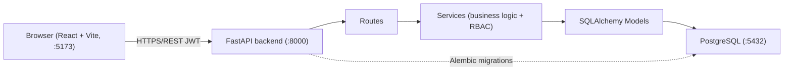

# Final Project Presentation — Blood Donation Manager

**Presenter:** Puneet Goswami
**Project:** Blood Donation Manager — Full-Stack Web Application
**Repository:** https://github.com/puneetg0/Blood-Donation

---

## 1. Project Title

Blood Donation Manager — a centralized platform for donor registration, blood request management, and donation coordination.

---

## 2. Problem Statement

Blood donation coordination is scattered across phone contacts, spreadsheets, messaging groups, and social media. This makes it hard to find current donor information by blood group and location, to know whether a donor is available, to track the status of blood requests (pending, in progress, fulfilled, cancelled), to maintain oversight of donor records and open requests, and to protect donor privacy. Hospitals, blood banks, requesters coordinating urgent needs, and volunteer donors all feel this friction. I built a digital, centralized solution with searchable records, role-based access control, request status tracking, and privacy-protected donor search.

---

## 3. Why I Chose This Project

I chose this project because blood donation is a real-world problem where coordination delays can cost lives. It let me practice a full Python full-stack: FastAPI backend, SQLAlchemy ORM, PostgreSQL, JWT authentication, and a React frontend with role-based access. It also forced me to think about privacy, authorization, and a clean API design — skills I want to demonstrate in interviews.

---

## 4. Target Users

- **Donors** — register, maintain availability, consent to being contacted.
- **Requesters** — create and track blood requests for patients.
- **Administrators** — oversee donors and requests, coordinate donations.

---

## 5. Features Implemented

1. Authentication — register, login, logout with JWT; session restore on refresh.
2. Role-based access — Donor, Requester, Administrator.
3. Donor registration — blood group, phone, city, availability, contact consent.
4. Donor search — filter consenting donors by blood group, city, availability; phone hidden.
5. Blood requests — create, view, update, cancel with status lifecycle.
6. Request status tracking — pending → in_progress → fulfilled/cancelled; full audit trail.
7. Donation coordination — admin links donors to requests and tracks contact status.
8. Dashboard — role-scoped statistics.
9. Responsive UI — mobile (600px), tablet (800px), desktop.

---

## 6. Technology Stack

| Layer | Technology | Purpose |
|-------|-----------|---------|
| Frontend | React 18 + Vite | UI framework and build tool |
| Styling | Custom CSS | Responsive, mobile-first |
| Frontend state | React Hook Form, React Router | Form validation, routing |
| Backend | FastAPI (Python) | REST API |
| ORM | SQLAlchemy | Modeling and queries |
| Database | PostgreSQL | Relational store |
| Migrations | Alembic | Schema versioning |
| Auth | JWT (python-jose) + bcrypt | Stateless tokens, hashed passwords |
| Validation | Pydantic | Request/response schemas |
| Testing | pytest | API workflow tests |
| DevOps | Docker, Docker Compose | Containerized deployment |
| CI/CD | GitHub Actions | Automated tests and lint |

---

## 7. System Architecture



Separation of concerns: routes handle HTTP, services hold business logic and authorization, models define persistence. Backend authorization is the source of truth; frontend role-gating is UX only.

## 8. Database Design

Tables: users, donors, blood_requests, coordinations, request_status_history.

- **users** — id, full_name, email (unique), password_hash, role, created_at.
- **donors** — id, user_id (FK), blood_group, phone, city, is_available, consent_to_contact.
- **blood_requests** — id, requester_id (FK), blood_group, units, hospital, city, urgency, status, created_at.
- **coordinations** — id, request_id (FK), donor_id (FK), contact_status, notes.
- **request_status_history** — id, request_id (FK), old_status, new_status, changed_by, changed_at.

Relationships: one user → one donor profile; one requester → many requests; one request → many coordinations and history rows. Primary-key lookups use `db.get(Model, id)` (HashMap-style).

---

## 9. API Flow

1. Client sends request with `Authorization: Bearer <jwt>`.
2. FastAPI dependency `get_current_user` decodes the JWT and loads the user.
3. `require_role(...)` enforces role permissions.
4. Route delegates to a service method that runs business rules (ownership checks, allowed status transitions).
5. Pydantic schemas validate input/output; SQLAlchemy persists to PostgreSQL.
6. Response returns validated JSON.

Key endpoints: `/api/auth/register`, `/api/auth/login`, `/api/auth/me`, `/api/donors`, `/api/donors/search`, `/api/requests`, `/api/coordinations`, `/api/dashboard`.

---

## 10. Live Project Demonstration

Complete user journey (≈5 min):

1. Register a donor account.
2. Create donor profile (blood group, phone, city, availability, consent).
3. Login as requester (separate account).
4. Create blood request (blood group, units, hospital, city, urgency).
5. Search donors (filter by blood group/location; phones hidden).
6. Admin coordination — login as admin, link donor to request, update coordination status.
7. Track request — pending → in_progress → fulfilled.
8. View dashboard — role-scoped stats update.

API demo: http://localhost:8000/docs (Swagger UI). Demo credentials: register any donor/requester; create admin via `python create_admin.py`.

---

## 11. Challenges Faced

1. Role-based authorization — donors see only open requests, requesters only their own, admins everything. Solved with `get_current_user` + `require_role` and ownership checks in every service method.
2. Request status lifecycle — preventing invalid transitions (e.g., pending → fulfilled). Solved with an `allowed_transitions` map validating every change.
3. Donor privacy — phones never exposed in search. Solved with a separate `DonorSearchOut` schema excluding contact fields plus `consent_to_contact` filtering.
4. Session persistence — login state across refreshes. Solved with AuthContext restoring token from localStorage and verifying via `/auth/me` on mount.

---

## 12. Bugs Fixed

- Donor search returned phone numbers → fixed with `DonorSearchOut` schema.
- Invalid status transitions allowed → fixed with `allowed_transitions` validation.
- Dashboard showed `pending_requests` instead of total → corrected stat.
- Unauthorized access to other users' requests → added ownership checks.
- Session lost on refresh → fixed via AuthContext token restore.
- No code regressions; all 5 backend tests still pass.

## 13. AI Tools Used and How They Helped

- **Cline (AI coding agent)** — scaffolding routes/services, generating Pydantic schemas, writing tests, and iterating on bugs quickly.
- **GitHub Copilot-style autocomplete** — boilerplate for models, migrations, and React components.
- **ChatGPT/Claude** — explaining FastAPI dependency injection, JWT flow, and debugging SQLAlchemy errors.

They accelerated boilerplate and debugging; I reviewed every generated change, ran tests, and kept authorization logic explicit and auditable.

---

## 14. Lessons Learned

- Backend authorization is the source of truth; frontend role-gating is UX only.
- Pydantic schemas give automatic validation and clear errors.
- Alembic migrations make schema changes safe and versioned.
- Tests first catch edge cases (duplicate emails, invalid transitions, unauthorized access).
- Separation of concerns (routes → services → models) keeps code maintainable.

---

## 15. Future Improvements

- Email notifications for status changes.
- Donor response to coordination (accept/decline).
- Request auto-expiry.
- Hospital directory and donation history.
- Distance-based search and admin analytics.

---

## 16. Mentor Q&A Preparation

**Technical decisions**
- Why FastAPI over Django/Flask? Async-friendly, auto OpenAPI docs, Pydantic integration, fast iteration.
- Why PostgreSQL? Relational data with foreign keys and transactions; Alembic migrations.

**Code structure** — routes → services → models; dependencies for auth; schemas separate from models.

**Database design** — 5 tables, FKs, history audit trail, PK lookups.

**API implementation** — REST, JWT bearer, Pydantic validation, status codes, ownership checks.

**React components** — AuthContext, protected routes, React Hook Form, role-scoped dashboards.

**Authentication** — bcrypt hashing, JWT 60-min expiry, `/auth/me` restore, RBAC via `require_role`.

**Git workflow** — feature commits, tagged v1.0.0, CI on push/PR to main.

**Best practices** — `.env` gitignored, tests, lint, Docker, migrations, separation of concerns.

---

## 17. DSA / Coding Practice

### A. Interview Questions — Backend / Python

#### 1. How does JWT authentication work, and how can we log out a user?

**Answer:**

JWT stands for JSON Web Token. It is used to check whether a user is logged in and allowed to access protected APIs.

The process works like this:

1. The user enters their email and password.
2. The backend checks whether the details are correct.
3. If they are correct, the backend gives the user a token.
4. The frontend sends this token when accessing protected APIs.
5. The backend checks the token before allowing access.

**How can we invalidate a token?**

- Set an expiry time for the token.
- Use refresh tokens to get new access tokens.
- Keep a list of revoked tokens when immediate logout is required.

Simply deleting a token from the frontend does not invalidate a copied token on the server.

**What I learned:** JWT helps protect APIs and allows the backend to identify logged-in users.

#### 2. What is a request status lifecycle, and how do you prevent invalid status changes?

**Answer:**

A request status lifecycle describes the different stages of a blood request.

For example, a request can move from pending to approved and then to fulfilled or cancelled, depending on the application's rules.

I can use a Python dictionary called `allowed_transitions` to define which status changes are allowed.

```python
allowed_transitions = {
    "pending": {"approved", "cancelled"},
    "approved": {"fulfilled", "cancelled"},
    "fulfilled": set(),
    "cancelled": set(),
}
```

Before changing a request's status, the backend checks whether the new status is allowed.

If the change is not allowed, the backend rejects it.

**What I learned:** Checking status changes helps prevent incorrect updates and keeps request information organized.

#### 3. How do you check user ownership and roles?

**Answer:**

Ownership and roles help control what each user can do.

- **Ownership:** Checks whether a record belongs to the current user.
- **Role:** Checks whether a user has permission to perform an action.

For example, a requester should not be allowed to edit another user's private blood request. An administrator may have additional permissions.

I can use FastAPI dependencies and backend service checks to verify the user's identity, role, and ownership before allowing an operation.

**What I learned:** These checks help protect user information and prevent unauthorized access.

### B. Interview Questions — React

#### 1. How do you keep a user logged in after refreshing the page?

**Answer:**

When we refresh a webpage, React's temporary state may be lost.

To restore the login state, an application can store an access token and check the user's session when the application starts.

The process is:

1. The user logs in.
2. The application stores the token using its chosen storage method.
3. When the page refreshes, the application checks the saved token.
4. The frontend calls an API such as `/auth/me` to get the current user's details.
5. React updates the login state.

If the token is invalid or expired, the application should ask the user to log in again.

**What I learned:** Authentication state helps the application remember the user's login status across page refreshes.

#### 2. How do you protect pages based on user roles?

**Answer:**

Some pages should only be available to certain users.

For example:

- Donors can access donor-related pages.
- Requesters can manage their own requests.
- Administrators can access administrative pages.

In React, I can create a `ProtectedRoute` component to check whether the user is logged in and has the required role.

If the user does not have permission, the application can redirect them to the login or unauthorized page.

The backend must also check permissions because frontend protection alone is not enough.

**What I learned:** Protected routes help users access only the pages intended for them.

#### 3. How do you validate forms in React?

**Answer:**

Form validation checks whether the information entered by a user is correct before submitting it.

For example, a donor registration form may require an email address, blood group, and city.

I can use React Hook Form to manage form values and errors. I can also use a validation library such as Zod to define the rules.

If the user enters incorrect information, the application displays an error message.

The backend must also validate the submitted information before saving it.

**What I learned:** Form validation helps prevent incorrect data and makes the application easier to use.

DSA Problem Solved — Search in Rotated Sorted Array (Medium)

Problem Statement

You are given a sorted array that has been rotated at an unknown position. Your task is to find the index of a given target number.

You must solve the problem in O(log n) time complexity.

Example 1:

Input:
nums = [4, 5, 6, 7, 0, 1, 2]
target = 0

Output:
4

Example 2:

Input:
nums = [4, 5, 6, 7, 0, 1, 2]
target = 3

Output:
-1
Approach

I used binary search to solve this problem efficiently.

The array is rotated, so the entire array is not sorted. However, at every step, at least one half of the search area is sorted.

Find the middle element.

If it matches the target, return its index.

Check which half is sorted.

Check whether the target lies within that half.

If it does, search that half. Otherwise, search the other half.

Continue until the target is found or no elements remain.

Python Code

def search_rotated_array(nums, target):
    left = 0
    right = len(nums) - 1

    while left <= right:
        mid = (left + right) // 2

        if nums[mid] == target:
            return mid

        # Check whether the left half is sorted
        if nums[left] <= nums[mid]:

            if nums[left] <= target < nums[mid]:
                right = mid - 1
            else:
                left = mid + 1

        # Otherwise, the right half is sorted
        else:

            if nums[mid] < target <= nums[right]:
                left = mid + 1
            else:
                right = mid - 1

    return -1


nums = [4, 5, 6, 7, 0, 1, 2]

print(search_rotated_array(nums, 0))  # 4
print(search_rotated_array(nums, 3))  # -1

Complexity Analysis

Time Complexity: O(log n), because the search area is reduced by approximately half in each step.

Space Complexity: O(1), because only a few extra variables are used.

### D. Final Learning Summary

Through these interview questions and coding practice, I improved my understanding of:

- JWT authentication and user login.
- Blood request status changes.
- User roles and ownership checks.
- React authentication and protected pages.
- Form validation.
- Binary search and time complexity.
- Explaining technical concepts in simple English.

This practice helped me revise the concepts used in my Blood Donation Manager project and prepare for technical interviews.

## 18. Deliverables

| Deliverable | Link / Location |
|-------------|-----------------|
| Final GitHub Repository | https://github.com/puneetg0/Blood-Donation |
| Complete Python Full Stack Project | `backend/` (FastAPI) + `frontend/` (React) |
| README Documentation | `README.md` |
| API Documentation | `docs/api.md` (plus Swagger at /docs) |
| Project Report | `FINAL_TASK_DOCUMENT.md` |
| Architecture Diagram | Not a separate file; see Section 7 of this document |
| Project Presentation | `PRESENTATION.md` |
| Final Reflection Report | Sections 11–14 of this document |

---

## 19. Conclusion

I delivered a full-stack Blood Donation Management System with authentication, role-based access, donor management, request tracking, and admin coordination. 5 backend workflow tests pass; ESLint and Python compile clean; responsive UI verified. Thank you — questions welcome.

Security verified: bcrypt hashing, JWT 60-min expiry, `.env` gitignored, phones hidden, role enforcement on every protected endpoint.
